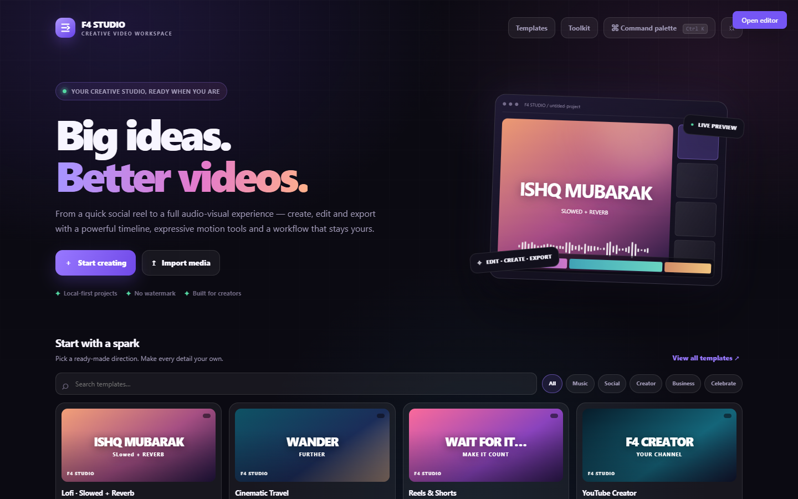
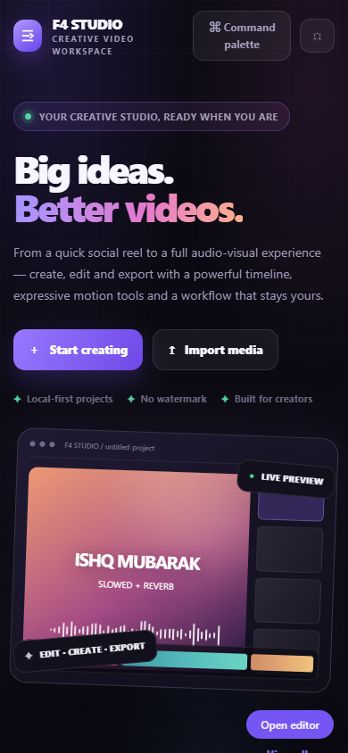
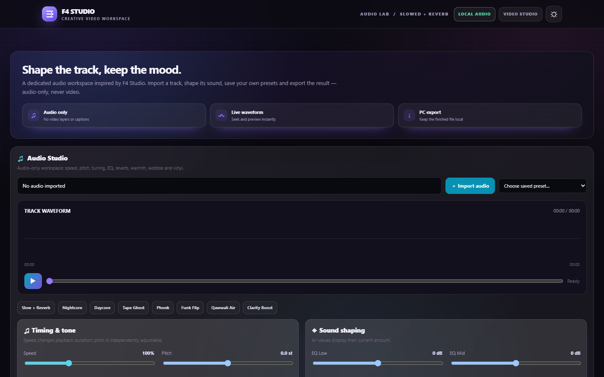
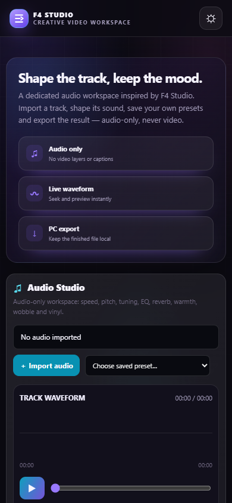
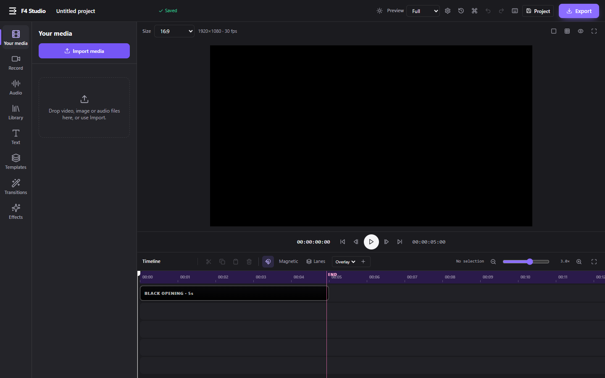
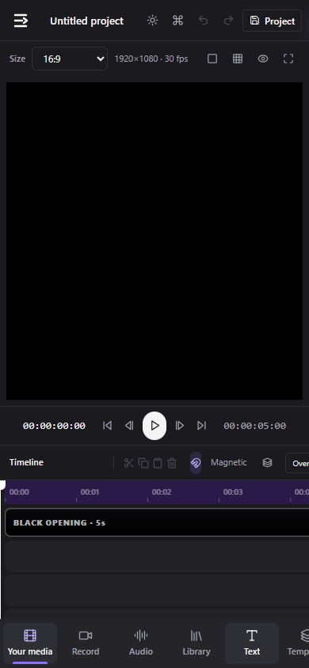

<div align="center">


# F4 Studio

### Local-first video editing · dedicated audio finishing · fast creative exports

<p>
  <a href="LICENSE"></a>
  
  
  
</p>

<p><a href="#what-f4-studio-is">Overview</a> · <a href="#video-studio">Video Studio</a> · <a href="#audio-studio">Audio Studio</a> · <a href="#install">Install</a> · <a href="#development">Development</a></p>
<p><strong>Edit locally. Export locally. No uploads. No watermark.</strong></p>

</div>

---

<table>
<tr>
<td width="50%"><strong>🎬 Video Studio</strong><br>Multitrack editing, motion, captions, effects, visualizers, recording, and local export.</td>
<td width="50%"><strong>🎧 Audio Studio</strong><br>A separate music changer for speed, pitch, EQ, reverb, cover art, MP3, and WAV.</td>
</tr>
<tr>
<td><strong>⚡ Local-first workflow</strong><br>Your media stays on your device. Browser and Electron builds process projects locally.</td>
<td><strong>📱 One responsive design</strong><br>Designed for phone, tablet, laptop, desktop, PWA, Windows, and Linux layouts.</td>
</tr>
</table>

## What F4 Studio is

F4 Studio is a responsive, local-first creative application developed by **[@f4did](https://github.com/f4did)**. It combines a major multitrack Video Studio with a separate, dedicated Audio Studio. Media stays on the user’s device; the browser/Electron shell performs editing, preview, analysis, and export locally.

The interface is designed as a modern dark production tool with a calm neutral canvas, violet/cyan highlights, compact controls, keyboard-friendly actions, responsive drawers, and a light-theme option. The same product adapts to phone, tablet, laptop, desktop, PWA, Windows, and Linux packaging layouts.

### Choose your route

| I want to… | Start here |
| --- | --- |
| Try the app without Node.js | Extract the offline ZIP and open the bundled browser launcher or Windows app. |
| Edit video | Open **Video Studio** from the enhanced home screen. |
| Change a song | Open **Audio Studio** from the home screen; it is a separate audio-only workspace. |
| Build from source | Run `npm install`, then `npm run dev`. |
| Ship a desktop build | Use the Windows, AppX, AppImage, `.deb`, or `.rpm` packaging commands below. |

> **Privacy note:** F4 Studio is local-first. It does not upload project media to a server during normal editing, preview, or export.

## UI gallery

The following captures are rendered from the current app at desktop and phone viewport sizes.

| Home — desktop | Home — phone |
| --- | --- |
|  |  |

| Audio Studio — desktop | Audio Studio — phone |
| --- | --- |
|  |  |

| Video Editor — desktop | Video Editor — phone |
| --- | --- |
|  |  |

The editor captures intentionally show the blank-project black opening on the timeline. Regenerate the gallery with `python scripts/capture-readme-screenshots.py` while the Vite server is running at `http://127.0.0.1:5173`.

## Video Studio

The main Video Studio is launched from the enhanced home screen in `f4-studio-home-enhanced.html`.

### Home and project flow

- Start a blank project, open a recent project, import a bundled template, or begin recording immediately.
- New blank video projects begin with a **five-second black canvas opening**. The opening is stored as project state and can be removed by the user from project settings.
- The home screen includes responsive cards, direct Record, Templates, Video Studio, Audio Studio, theme switching, GitHub/Telegram links, and local export history.
- Export history records project name, file name, format, resolution, size, render duration, and export time. It does not play exported files because the exported file belongs to the user’s computer, not F4 Studio’s media database.

### Timeline and media

- Multitrack video and audio timeline with clip selection, move, trim, split, duplicate, copy/paste, delete, ripple insert/delete, magnetic close gaps, slip, slide, snapping, markers, track locking, visibility, and mute controls.
- Import local video, audio, and image files. Media is decoded by the browser’s native capabilities and stored locally for project work.
- Add generated music, sound effects, backdrops, stickers, shapes, and bundled sample media.
- Record screen, camera, and voice-over directly into the project.
- Save and reopen a complete project as a `.f4proj` bundle, including project JSON and media blobs.

### Text, animation, and visual design

- Text, captions, subtitles, title cards, credits, stopwatch, and countdown layers.
- Text styling includes font family, local font loading, size, weight, tracking, line height, alignment, color, gradients, outline, shadow, and background treatment.
- The animation registry provides **50 selectable text animation presets**. Animations are deterministic and frame-bounded so preview and export remain consistent.
- Supported animation families include fades, slides, wipes, reveals, kinetic text, path motion, 3D-style motion, blur/scale, looping motion, gradient motion, caption highlights, and expression-based movement.
- Subtitle import/export includes SRT parsing, multiline cues, comma timecodes, frame alignment, serialization, and proportional timing for plain transcripts.

### Transitions and effects

- **30 previewable transition presets** with category grouping and visual tiles.
- Cross-dissolves, fades, wipes, zoom/spin, blur, creative transitions, and other timeline-safe transition renderers.
- **40+ filter/effect presets** covering blur, colour, light, texture, chroma key, masks, advanced colour treatment, and creative looks.
- Effects remain editable on the selected clip and are checked for export capability before rendering.

### Audio visualizer

The Video Studio keeps its audio visualizer. It is part of the video composition system, not the separate Audio Studio.

The main mockwave uses the requested lofi dotted-spike style: a row of narrow `<i>` bars inside `#mockwave`, each with a fixed height and a staggered negative animation delay. This creates the tight, organic waveform motion seen on the home design. The editor also supports spectrum-style visualizer clips driven by an audio source, including deterministic levels for preview and export. Silence produces low levels instead of disappearing layout, so the composition stays stable.

## Audio Studio

Audio Studio is intentionally separate from the Video Studio editor. It opens from the home page at `F4-Audio-Studio-Modern-F4-Home-Design.html` and fills the window with its own modern audio-focused UI.

It has no video backdrop, text, caption, video filter, or video timeline workflow. All controls operate on the audio signal:

- Import an audio track and edit title/name and artist metadata.
- Attach a cover image/thumbnail for the audio release.
- Change speed: faster playback reduces duration; slower playback increases duration.
- Choose tape-style speed/pitch behaviour or keep-pitch processing where supported.
- Tune pitch, apply EQ, reverb, warmth, wobble, vinyl character, and other music-changer controls.
- Use audio presets and preview the processed track before export.
- Export MP3 or WAV locally.
- Keep the Audio Studio’s responsive dark/light theme, readable contrast, upgraded top bar, and extra control cards.
- Click the F4 logo to return to the main home page; browser history preserves the separate route.

## Export and performance

Video export uses the browser-side FFmpeg/WebCodecs-capable path, fast seek behaviour, project-aware source mapping, even canvas dimensions, requested FPS/resolution, bitrate or quality controls, and supported audio/video muxers. Audio export mixes once and encodes directly rather than rendering a second full video pass.

The export screen exposes format, resolution, FPS, quality/speed, file name, and estimated output details. Always test a short section first when working with a long or heavily filtered project: browser hardware, codec support, resolution, effects, and source media can dominate render time.

## Responsive design

- Phone: compact drawers, stacked cards, touch-sized controls, safe viewport padding, and installable PWA mode.
- Tablet: split preview/timeline layout with collapsible side panels.
- Laptop/desktop: three-column editor with media/tools, preview, timeline, inspector, resizers, keyboard shortcuts, and command palette.
- Home and Audio Studio use fluid grids, theme variables, readable contrast, and no fixed-width dependency.

## Install

There are two ways to use F4 Studio:

1. **Regular/offline use:** extract `F4-Studio-Offline-Windows.zip` and open `windows-portable/F4 Studio.exe`. This path includes Electron and the built application, so Node.js, npm, and `npm install` are not required.
2. **Browser mode without Node:** extract the ZIP, open `offline-launcher/`, and double-click `Open F4 Studio Browser.cmd`. It starts a localhost-only PowerShell server and opens `web-dist/` in the browser.
3. **Linux browser mode:** extract the ZIP, open a terminal in `offline-launcher/`, and run `python3 open-browser.py` or `sh "Open F4 Studio Browser.sh"`.
4. **Development/production rebuilds:** use Node.js and npm to run the Vite development server, tests, production build, or platform packagers.

The ZIP also contains `web-dist/` for deployment as a browser/PWA site. Modern browsers do not support the full application reliably from a raw `file://` double-click because ES modules, fetch, FFmpeg WebAssembly, and service workers need an HTTP origin. For a browser-only deployment, serve `web-dist/` over localhost or HTTPS; for a no-setup Windows user, open the bundled Electron executable.

### Windows desktop

Requirements: Windows 10/11, Node.js for building, and the normal Windows installer for end users.

Build the web app and installer:

```powershell
npm install
npm run desktop:dist
```

The NSIS installer is created under `desktop/dist`. Run the installer, select an installation directory, and launch **F4 Studio** from the Start Menu or Desktop shortcut. The installed NSIS version registers with Windows Apps/Programs and Features. The portable `.exe` is a self-contained run-anywhere build and intentionally does not register as an installed program.

For a portable build:

```powershell
npm run desktop:portable
```

To create the complete no-Node ZIP after building:

```powershell
npm run package:offline
```

The generated `F4-Studio-Offline-Windows.zip` contains the Windows runtime, the browser build, this README, and `OFFLINE-START.txt`. It is self-contained for Windows regular use; it is not an Android APK or a Linux package.

Public Windows distribution should use a trusted Authenticode certificate. Without signing, Smart App Control/SmartScreen may warn or block the executable.

## Code signing policy

Free code signing provided by SignPath.io, certificate by SignPath Foundation. F4 Studio’s release/signing roles, provenance rules, privacy statement, and approval process are documented in [CODE-SIGNING-POLICY.md](CODE-SIGNING-POLICY.md). The public-source build workflow is [`.github/workflows/build.yml`](.github/workflows/build.yml).

The GitHub workflow runs tests, builds the Windows installer from this repository, uploads the unsigned artifact as a GitHub Actions artifact, and can submit it to SignPath’s official signing action when manually requested with the required SignPath project variables and `SIGNPATH_API_TOKEN` secret. Signing remains subject to SignPath Foundation eligibility and manual approval.

See [docs/SIGNPATH-CHECKLIST.md](docs/SIGNPATH-CHECKLIST.md) for the verified repository work and the remaining GitHub/SignPath release actions.

### Microsoft Store / Windows package

The Electron configuration includes an x64 AppX target, which is the package route used for Microsoft Store workflows:

```powershell
npm run desktop:store
```

Before Store submission, replace the placeholder AppX publisher identity with the exact identity issued by Partner Center, use matching Store display metadata, and sign/package according to the Store requirements.

### Linux desktop

Build targets are configured for AppImage, Debian, and RPM:

```bash
npm install
npm run desktop:linux
# or: npm --prefix desktop run dist:linux
```

Use the AppImage on most distributions, `.deb` on Debian/Ubuntu-based systems, and `.rpm` on Fedora/RHEL/openSUSE-based systems. Native Linux packaging should be run on Linux or in a Linux CI runner so the correct platform dependencies and architecture are used.

### Phone / Android

The most direct phone installation is the installable PWA:

1. Run `npm run build`.
2. Serve `dist/` over HTTPS.
3. Open the site in Chrome/Edge on Android.
4. Choose **Install app** / **Add to Home screen**.

The repository includes the manifest, service worker, standalone display mode, icons, phone viewport, `.f4proj` file handler, and a Record shortcut. A distributable APK is a separate Android wrapper build and requires Java, Gradle, Android SDK platforms/build-tools, a configured Capacitor/WebView wrapper, an application ID, and APK signing credentials. The web/PWA build must remain the source of truth so the APK does not fork the editor UI.

The same ZIP is cross-platform at the web layer: Android users can extract or copy `web-dist/` to HTTPS hosting and install it as a PWA; Linux users can use the included Python launcher or a native AppImage/DEB/RPM package. The Windows executable inside the ZIP is Windows-only. A native Android APK remains a separate signed wrapper build.

## Development

```bash
npm install
npm run dev
npm test
npm run typecheck
npm run build
```

The Vite dev server sends COOP/COEP headers required by the FFmpeg WebAssembly path. Current browser targets are Chrome/Edge/Firefox/Safari; WebCodecs-based export is strongest in Chromium browsers.

## Repository map

| Path | Purpose |
| --- | --- |
| `src/` | React application, editor layout, timeline, inspector, engines, and state |
| `f4-studio-home-enhanced.html` | Active responsive home source |
| `F4-Audio-Studio-Modern-F4-Home-Design.html` | Dedicated Audio Studio source |
| `src/engine/` | Playback, export, FFmpeg, audio processing, project I/O, recording, and PWA helpers |
| `src/core/` | Timeline operations, templates, presets, models, animations, subtitles, and export rules |
| `public/` | Manifest, service worker, icons, and static runtime assets |
| `desktop/` | Electron shell, Windows installer, Store AppX, and Linux targets |
| `assets/` | Bundled media samples used by the library and templates |
| `tests/` | Core behaviour, animation, timeline, audio, muxer, and export tests |
| `ARCHITECTURE.md` | Technical architecture notes |
| `FEATURE_STATUS.md` | Feature matrix and test coverage notes |

`dist/`, `desktop/dist/`, and `node_modules/` are generated/runtime directories. They are not source-of-truth files and should be regenerated rather than edited manually.

## Developer credits

Designed and developed by **[@f4did](https://github.com/f4did)**.

Community standards are in [CODE_OF_CONDUCT.md](CODE_OF_CONDUCT.md), and vulnerability reporting is documented in [SECURITY.md](SECURITY.md).

## License

F4 Studio is released under the [Apache License 2.0](LICENSE). The license permits use, modification, distribution, and sublicensing under its terms. F4 Studio branding and trademarks remain attributable to the project and developer.

<div align="center"><sub>F4 Studio · local-first creative tools</sub></div>
